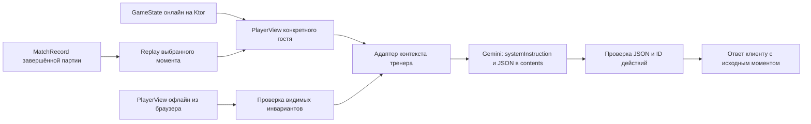

# Реализация тренера: состояние, обмен и очередь работ

Реализовано 15 октября 2026 поверх main `49b2c14`; [публикация](testing/trainer-public.md).
Нормативный контракт — [trainer-api.md](trainer-api.md). Этот документ объясняет,
как получить данные и какие части реализовать. Результаты проверок — [trainer-integration.md](testing/trainer-integration.md).

## Откуда берётся состояние

| Объект | Источник | Содержание | Передаём Gemini |
| --- | --- | --- | --- |
| GameState | Общий движок, онлайн на Ktor, офлайн в браузере | Все руки и внутреннее состояние | Нет |
| PlayerView | GameEngine.view(state, seat) / JS playerView | Сведения для одного игрока, options, currentPoints | Да, через адаптер |
| MatchRecord | Экспорт движка; setups + actions + версии | Исходные раздачи и последовательность команд | Нет: сначала replay и проекция |
| Контекст тренера | Новый серверный адаптер | Проекция, правила, момент, кандидаты, вопрос, история | Да |

Состояние для Gemini — **не экспорт партии**. Полный импорт содержит закрытые карты;
передача его в player-режиме нарушает требования. Преобразование использует
существующую проекцию, а не новое параллельное описание правил в TypeScript.

Онлайн-клиент отправляет стол, expectedRevision и вопрос. Сервер получает место
из гостевой сессии, фиксирует GameState и PlayerView атомарно, затем освобождает
блокировку. Запрос модели не ждёт игровой таймер и не блокирует WebSocket.
Для API используются места движка; поворот столов в интерфейсе выполняется
только при отображении. Нельзя заменить серверный seat визуальным SOUTH.

Офлайн-клиент передаёт PlayerView и глобальный actionIndex. Полный локальный
GameState остаётся в браузере. Проверка сервера ограничена доступными данными:
нельзя подтвердить скрытые руки или подлинность локального матча.

В review сначала проверяется **полный** record и его завершение, затем
восстанавливается выбранный префикс. Replay требует также корректного выбора
setups по actionOffset: одно лишь усечение actions недостаточно при переходе
между раздачами. При совпадении границы пересдачи момент содержит dealNumber;
клиент должен выбрать раздачу явно, сервер разрешает её только если replay
подтверждает этот момент. Для этого source.review дополнительно содержит
`dealNumber: integer >= 1`; source.offline берёт его из view.
В player-режиме итогом является GameEngine.view на выбранный seat.
В all_hands отдельно разрешаются руки восстановленного состояния.

Третий карточный ход второй раздачи означает: в текущей первой взятке уже две
карты, сейчас выбирается третья. Это не третье Action во всей партии:
торговля, объявления и решения по реконтре тоже занимают actionIndex.
Индекс N означает состояние **после N применённых действий**.

## Файлы примеров

- [context-deal2-card3.json](examples/trainer/context-deal2-card3.json): внутренний
  контекст, полный текст профиля 0.2, собственная рука SOUTH, две публичные карты.
- [gemini-request-deal2-card3.json](examples/trainer/gemini-request-deal2-card3.json):
  тело REST generateContent с systemInstruction, contents и JSON Schema.
- [trainer-system-prompt.txt](trainer-system-prompt.txt): постоянная инструкция v1.
- [trainer-model.schema.json](trainer-model.schema.json): серверная схема ответа.

PlayerView в примерах получен из реального JS-движка: seed 17, первая раздача
с контрактом 8 червей, затем nextDeal с seed 18 и такой же торговлей до двух
сыгранных карт. Момент — actionIndex=45, SOUTH должен выбрать объявление перед
своей третьей картой взятки; сама третья карта ещё не сыграна. Число карточных
ходов не совпадает с количеством команд движка. Совпадение проекции с replay
проверяется также отдельным серверным тестом. Пример содержит все публичные
события движка, включая предыдущую раздачу, без скрытых текущих рук.
[Пример ответа сервера](examples/trainer/trainer-response-deal2-card3.json)
получен реальным вызовом Gemini за 9,35 секунды; системный промпт затем уточнён
для русских названий действий, остальные поля и схема сохранены.
Полный профиль в примере составлен из profile-v1 и дополнения profile-v2;
правила 0.2 имеют приоритет в части ручных объявлений и currentPoints.

Запрос отправляется сервером на
`https://generativelanguage.googleapis.com/v1beta/models/gemini-3.8-flash:generateContent`.
API-ключ идёт только в X-goog-api-key, его нет в файлах примеров.
В contents JSON сериализован **как строка text**, как требует Gemini REST;
это не прямой HTTP-контракт клиентского POST /api/trainer.
Модель возвращает только объект по responseJsonSchema, сервер добавляет
requestId/moment/perspective/validation и заменяет ID на Action.

Образец использует responseJsonSchema; ранее проверенный запрос использовал
responseSchema. В реализации выбирается один поддерживаемый вариант, без
одновременной передачи обоих. Серверный адаптер проверен реальным запросом: передаёт responseJsonSchema
без minLength/maxLength/pattern, которые проверяются на сервере.

## Изменения по компонентам

| Компонент | Требуемая работа |
| --- | --- |
| Kotlin trainer DTO | Версионированные source/request/answer/error, строгий разбор |
| ContextBuilder | Профиль по версии, проекция, moment, фильтрация истории |
| CandidateBuilder | Все разрешённые карты/флаги, ограниченные ставки; declare/decline-declarations |
| GeminiClient | Ktor HTTP client, secrets, JSON Schema, тайм-ауты и ошибки |
| AnswerValidator | ID → Action, формат, ruleRefs, допустимость на исходном моменте |
| TrainerService | Авторизация, снимок, дедупликация, вызов без lock |
| POST /api/trainer | Заменить текущий 503 полноценным контрактом |
| web/src/lib/trainer.ts | Строгие типы, весь ответ, requestId/source вместо произвольного context |
| Coach / история | Показ совета и альтернатив, прошлый момент, режим раскрытых карт |
| IndexedDB / экспорт | Сохранение структурированного ответа, явная версия и миграция чата |

Новые DTO тренера — отдельная версия протокола, не изменение игрового WS.
Версия правил 0.2 не означает новую версию MatchRecord: текущий formatVersion=1.
Если меняется внешняя оболочка экспорта чата, версия меняется именно у неё.
System prompt в txt — канонический источник; блок в trainer-api должен совпадать.
При реализации prompt/schema/профили включаются в серверные ресурсы сборкой:
production-контейнер не должен зависеть от наличия каталога docs на диске.
Автоматических замен профиля старых матчей не допускается.

## Порядок реализации и проверок

1. P04: проверить реальные игровые примеры, квоту, задержки и расход thinking;
   доступ к модели уже проверен, стратегическое качество ещё нет.
2. P05: DTO, prompt/profile resources, offline ContextBuilder, кандидаты,
   GeminiClient, валидатор и route. Затем клиент, сохранение ответа и ошибки.
3. P06: replay завершённого record, выбор момента/перспективы, фильтрация
   будущих сообщений и сведений, экспорт/импорт структурированного чата.
4. P09: авторизованный серверный онлайн-снимок, revision, серверные координаты,
   ответы о прошлом моменте и независимость от таймера/WS.

Автотесты — без внешней сети и настоящего ключа. Проверяются обе версии профиля,
declare/decline-declarations, карты, торговля и контра вне очереди; неправильные
ID/JSON/профили, тайм-аут, 429/503, stale revision, повторы requestId, приватность
и сохранение чата. Минимум один fixture получают **из реального движка** во
второй раздаче до третьей карточной игры и проверяют согласованность с replay.
Отдельный браузерный сценарий подтверждает, что онлайн продолжает играть,
пока mock провайдера задерживает ответ, и поздний ответ помечается прошлым.
Текстовые ошибки стратегии проверяются человеком на реальной модели.

Тайм-ауты, размер тела, кратковременный кеш, диапазон рекомендуемых ставок
и лимиты истории из trainer-api — стартовые предложения. Из ранее принятых
ограничений не выводится запрет других законных ставок или лимит попыток кода.
Публичный Render уже существует; данная задача не включает деплой или запись ключа.
